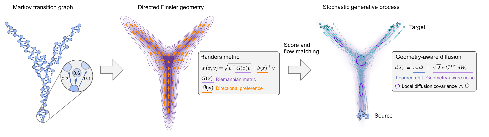

# Finsler Flow Matching - Dynamics-Aware Geodesic Interpolation for Single-Snapshot Trajectory Inference

Code for the paper [Finsler Flow Matching: Dynamics-Aware Geodesic Interpolation for Single-Snapshot Trajectory Inference](https://arxiv.org/abs/2610.11318).

Finsler Flow Matching (FFM) is a framework for learning continuous stochastic dynamics from discrete Markov transition graphs. Single-cell snapshot data resolve a continuum of cellular states but do not uniquely determine the dynamics between them; RNA velocity, lineage tracing, metabolic labelling and experimental time points can instead be encoded in a cell-cell Markov transition kernel. FFM uses the first and second local moments of this kernel to construct a Randers metric motivated by the Freidlin-Wentzell action, where the second moment determines anisotropic accessibility and the first moment introduces a preferred direction of motion. It learns neural approximations of the resulting directed geodesics, uses their Finsler cost to construct source-target couplings, and distills geometry-aware stochastic conditional paths into a continuous generative process through simulation-free score and flow matching.

<p align="center">
  
</p>

## Example Applications

- Recovering withheld intermediate populations from a single snapshot under pseudotime hold-out ([pancreas](notebooks/pancreas.ipynb), [erythroid](notebooks/erythroid.ipynb), [itracer](notebooks/itracer.ipynb))
- Interpolating withheld experimental time points in time-course data ([erythroid](notebooks/erythroid.ipynb), [embryoid_body](notebooks/embryoid_body.ipynb))
- Combining expression, RNA velocity and lineage tracing in one transition kernel ([itracer](notebooks/itracer.ipynb))
- Predicting cell-specific fate probabilities from stochastic trajectories ([pancreas](notebooks/pancreas.ipynb), [larry](notebooks/larry.ipynb))
- Following directed, anisotropic dynamics on synthetic manifolds ([sheet](notebooks/sheet.ipynb), [forksheet](notebooks/forksheet.ipynb))

## Installation

Install the package, which imports as `ffm`:

```bash
pip install git+https://github.com/mlbelab/FinslerFlowMatching.git
```

To reproduce the paper, clone the repository and install it in editable mode:

```bash
git clone https://github.com/mlbelab/FinslerFlowMatching.git
cd FinslerFlowMatching
pip install -e ".[notebooks]"
```

`requirements-lock.txt` pins the environment of the reported runs.

## Usage

```python
import ffm

cfg = ffm.Run.from_env()
m, C = ffm.moments_from(P, X)
metric = ffm.FWFactory(X, C, m, cfg, rho_mult=1.0, lam_mult=0.3).base
X0, X1 = cfg.tensor(X[source]), cfg.tensor(X[target])
det = ffm.path_a(metric, X0, X1, seed=0, cfg=cfg)
sde = ffm.path_b(metric, det["phi"], det["coupler"], X0, ffm.sigma_for(metric, 0.3), seed=0, cfg=cfg)
```

`X` holds the observed states, `P` the row-stochastic transition matrix, and `source`, `target` index $p_0$ and $p_1$. `moments_from` returns the first and second transition moments, `FWFactory` the regularized Freidlin-Wentzell Randers metric, `path_a` trains the geodesic interpolant, the Finsler coupling and the flow, and `path_b` the score and flow of the stochastic model on the same interpolant and coupling; both return trajectories under `"traj"`. The documentation in [`docs/`](docs) describes the [method](docs/method.md) and the [API](docs/api.md).

## Reproducing the paper

One notebook per dataset. Each reads the run records under `outputs/`, recreates missing records with the drivers that produced them, and shows the paper's tables and figures together with the midpoint and endpoint $W_2$ of every method (endpoint only for LARRY; ForkSheet and the geodesic benchmark report recall and geodesic error).

| Notebook | Dataset | Hold-out | Paper |
|---|---|---|---|
| [sheet](notebooks/sheet.ipynb) | Sheet, 4,000 points on a saddle in $\mathbb{R}^3$ | transition corridor | Fig. 2, Fig. 3, Table 10 |
| [forksheet](notebooks/forksheet.ipynb) | Bifurcation, 3,000 points in $\mathbb{R}^3$ | middle split | Fig. 5, Table 9 |
| [pancreas](notebooks/pancreas.ipynb) | Pancreatic endocrinogenesis (Bastidas-Ponce et al., 2019) | middle pseudotime tertile | Tables 1, 2, 4, 5, 6, 8, 10, Fig. 4 |
| [erythroid](notebooks/erythroid.ipynb) | Mouse erythroid development (Pijuan-Sala et al., 2019) | middle pseudotime tertile; E8.0 and E8.25 | Tables 1, 7 |
| [embryoid_body](notebooks/embryoid_body.ipynb) | Embryoid body (Moon et al., 2019) | each of days 1-3 | Table 1 |
| [itracer](notebooks/itracer.ipynb) | iTracer hindbrain organoid (He et al., 2022) | middle diffusion-pseudotime tertile | Table 2 |
| [larry](notebooks/larry.ipynb) | LARRY hematopoiesis (Weinreb et al., 2020) | held-out clones | Table 2 |
| [geodesics](notebooks/geodesics.ipynb) | Analytic Randers and sphere metrics | | Table 3 |

```bash
jupyter nbconvert --to notebook --execute --inplace notebooks/pancreas.ipynb
```

`FFM_NO_TRAIN=1` turns a missing record into an error instead of a training run, and `NB_CPU=1` forces the CPU. On Pancreas, Erythroid and iTracer, RNA velocity, the transition graph and the derived geometric quantities are recomputed after removing the evaluation cells; on Embryoid Body, the principal components and Curly-FM's velocity come from the all-cell TrajectoryNet release, and on LARRY, PCA and velocity are fit on the Day-2 and Day-6 cells.

### Repository

```
ffm/          the method (pip install -e .)
  method/     moments, Randers metric, interpolant, Finsler OT, score and flow matching
  core/       transition kernels, arms, bridges, couplings, metrics, vendored baselines
scripts/      experiment code per dataset: data, splits, training drivers, paper tables
notebooks/    one notebook per dataset; figures in notebooks/out
outputs/      run records behind every table
data/         derived caches
docs/         documentation
tests/        unit tests and the paper-table checks run by CI
```

### Data

| Cache | Data | Rebuild |
|---|---|---|
| `pancreas_cache_refit/` | Bastidas-Ponce et al. (2019); scVelo on the shown cells, plus `band5`, `band35` and `fate` | `python -m ffm.core.scvelo_data --rebuild --path <h5ad>`, then `python -m scripts.pancreas.leakage build --raw <h5ad> --names trainonly,band5,band35,fate` |
| `erythroid_cache_refit/` | Pijuan-Sala et al. (2019), the Curly-FM erythroid subset; UniTVelo on the shown cells | `python -m scripts.erythroid.preprocess`, then `python -m scripts.erythroid.leakage` `pca`, `refit --cells trainonly`, `build --cells trainonly`, and copy `outputs/erythroid_leakage/cache_trainonly` |
| `erythroid_stage_cache/` | the same cells by capture stage, E7.0-E8.5 | `python -m scripts.erythroid.stage_data long` |
| `eb_cache/` | Moon et al. (2019), TrajectoryNet release | `python -m scripts.eb.bench prepare` |
| `itracer/` | He et al. (2022) | `python -m scripts.itracer.velocity` `preflight`, `fetch`, `ref`, `joincheck`, `count`, `assemble` |
| `larry_cache/` | Weinreb et al. (2020) | `python -m scripts.larry.data --raw <h5ad>`, then `python -m scripts.larry.fate clones` |

Rebuilding the caches needs `pip install -e ".[singlecell]"`, and the Erythroid steps a separate UniTVelo/TensorFlow environment.

## Contributing

```bash
pip install -e ".[test]" pre-commit
pre-commit install
pytest
```

## License

FFM is released under the [MIT License](LICENSE). The vendored LAND metric of Metric Flow Matching (Kapusniak et al., 2024) and the interpolant, coupling and MLP utilities of Curly Flow Matching (Petrović et al., 2025) in `ffm/core/vendor/` keep their MIT licences; OT-CFM and [SF]²M (Tong et al., 2024) are reimplemented in `ffm/core/arms.py`.

## Citation

```bibtex
@misc{canova2026finsler,
  title         = {Finsler Flow Matching: Dynamics-Aware Geodesic Interpolation for Single-Snapshot Trajectory Inference},
  author        = {Niklas Canova and Jonas Simon Fleck},
  year          = {2026},
  eprint        = {2610.11318},
  archivePrefix = {arXiv},
  primaryClass  = {cs.AI},
  url           = {https://arxiv.org/abs/2610.11318}
}
```
