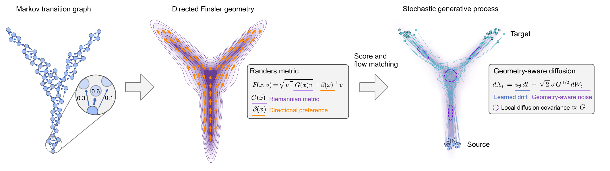

# Finsler Flow Matching

**Dynamics-Aware Geodesic Interpolation for Single-Snapshot Trajectory Inference**

Code for the paper [Finsler Flow Matching: Dynamics-Aware Geodesic Interpolation for Single-Snapshot Trajectory Inference](https://arxiv.org/abs/2610.11318).



A discrete Markov transition graph is converted into a continuous directed Finsler geometry, which guides score and flow matching to define a stochastic generative model with geometry-aware diffusion.

Single-cell snapshot data can resolve a continuum of cellular states but do not uniquely determine the dynamics governing transitions between them. Additional dynamical information, from RNA velocity, lineage tracing, metabolic labelling or experimental time points, can often be encoded in a cell-cell Markov transition kernel. Finsler Flow Matching (FFM) learns continuous stochastic dynamics from such a kernel: its first and second local moments define a Randers metric motivated by the Freidlin-Wentzell action, FFM learns neural approximations of the resulting directed geodesics, uses their Finsler cost to construct source-target couplings, and distills geometry-aware stochastic conditional paths into a continuous generative process through simulation-free score and flow matching.

```{toctree}
:maxdepth: 2
:caption: Getting started

installation
method
api
```

```{toctree}
:maxdepth: 1
:caption: Reproducing the paper

notebooks/sheet
notebooks/forksheet
notebooks/pancreas
notebooks/erythroid
notebooks/embryoid_body
notebooks/itracer
notebooks/larry
notebooks/geodesics
```
